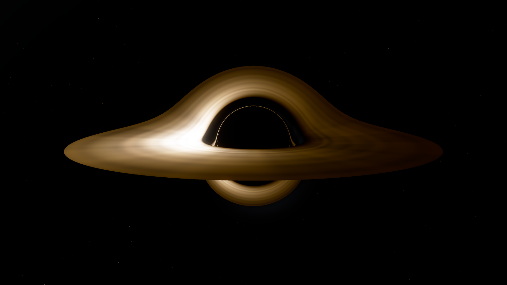
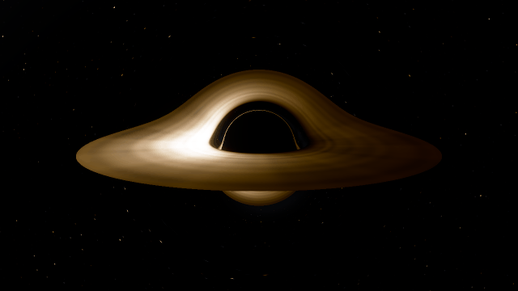
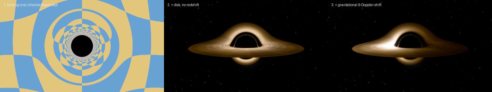
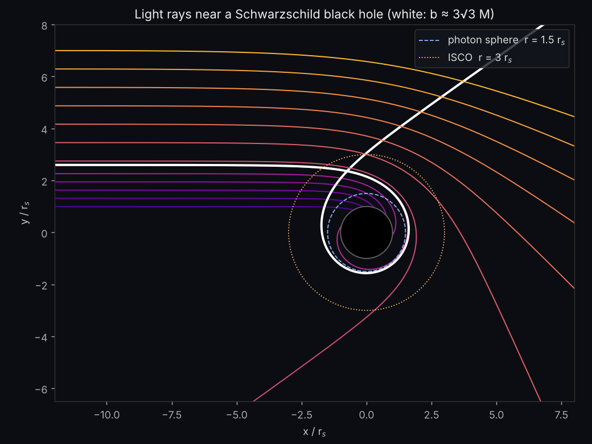
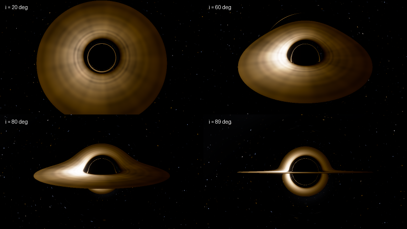

<div align="center">

# event-horizon

**A physically based Schwarzschild black hole ray tracer in pure NumPy**




</div>

Every pixel is a light ray traced *backwards* from the camera through curved
spacetime around a non-rotating black hole. Nothing is faked: the halo over
the top of the hole is the far side of the disk, its light bent up and over by
gravity; the thin bright ring hugging the shadow is light that orbited the
hole before escaping; and the left side is brighter and bluer because that gas
is rushing toward you at about half the speed of light.

<div align="center">



*The disk animated with Keplerian rotation. The inner gas laps the outer gas, so the streaks wind up into spirals.*

</div>

## Features

- **Exact null geodesics** of the Schwarzschild metric, vectorised over every pixel with RK4 and adaptive steps
- **Thin accretion disk** from the ISCO (6M) outward, with a Novikov–Thorne-style temperature profile
- **Full relativistic shading**: gravitational redshift, transverse Doppler, and Doppler beaming (I ∝ g⁴) from one conserved-quantity formula
- **Real blackbody colours**: Planck spectra integrated against the CIE 1931 colour-matching functions
- **Procedural star field** that gets lensed into Einstein rings and duplicated images
- **Validated against analytic GR** with a test suite: photon sphere, light bending, turning points, and shadow size
- One trace per frame; re-shading is cheap, so animations of the rotating disk are fast

## Quick start

```bash
git clone https://github.com/YOUR-USERNAME/event-horizon
cd event-horizon
pip install -e .

python -m blackhole render -o bh.png                       # 960x540, about a minute
python -m blackhole render --inclination 89 --sky checker  # edge-on, lensing grid
python -m blackhole animate --width 480 --height 270 -o spin.gif
python examples/make_figures.py                            # rebuild every README image
```

From Python:

```python
from blackhole import Scene, Camera
from PIL import Image

scene = Scene(camera=Camera(1280, 720, inclination=80, distance=30))
Image.fromarray(scene.image()).save("bh.png")
```

## How it works



### 1. Light rays in curved spacetime

Units are $G = c = 1$ with the Schwarzschild radius $r_s = 2M = 1$. A photon
moving in the plane of its orbit obeys ($u = 1/r$)

$$\frac{d^2u}{d\varphi^2} + u = 3Mu^2 .$$

The $3Mu^2$ term is general relativity's correction. Without it, light goes in straight lines.

**The trick.** Binet's formula says a Newtonian particle under a central
force $F(r)$ traces orbits obeying $u'' + u = -F/(h^2u^2)$, where $h = |\mathbf{x}\times\mathbf{v}|$.
Choosing

$$\mathbf{a} = -\frac{3}{2}\,h^2\,\frac{\mathbf{x}}{|\mathbf{x}|^5}$$

reproduces the photon equation *exactly*. Each ray is therefore a simple 3-D
Cartesian ODE: no Christoffel symbols, no coordinate singularities at the poles,
and it vectorises across hundreds of thousands of pixels at once. Rays are
integrated with RK4 using a step $\Delta t = 0.04\,r$, which is fine near the hole and
coarse far away.

A ray stops when it:
- falls through the horizon ($r < r_s$) and the pixel is black,
- crosses the disk plane between $r_\text{in}$ and $r_\text{out}$, or
- escapes outward past $r \gg r_s$, in which case the pixel looks up its final direction on the sky.



Rays with impact parameter $b < b_c = 3\sqrt3\,M \approx 2.60\,r_s$ are captured.
That critical value sets the size of the **shadow**, which appears about 2.6× larger
than the horizon. Rays just above $b_c$ wrap around the **photon sphere**
($r = 3M$) and form the thin photon ring.

### 2. The accretion disk

Gas orbits on circular geodesics down to the innermost stable circular orbit,
$r_\text{ISCO} = 6M = 3\,r_s$. A thin disk's temperature is

$$T(r) \propto r^{-3/4}\left(1 - \sqrt{r_\text{in}/r}\right)^{1/4},$$

which peaks at $r = \tfrac{49}{36}r_\text{in}$.

### 3. Redshift and beaming

Gas moves with 4-velocity $u^\mu = u^t(1, 0, 0, \Omega)$, where $\Omega = \sqrt{M/r^3}$ and
$u^t = (1 - 3M/r)^{-1/2}$. A photon carries conserved energy $E$ and angular momentum $L_z$.
Comparing $p_\mu u^\mu$ at emission and reception, with a static observer at $r_\text{obs}$, gives

$$1 + z = \frac{1}{g} = u^t\left(1 - \Omega\,\frac{L_z}{E}\right)\sqrt{1 - \frac{2M}{r_\text{obs}}} .$$

This single expression contains gravitational redshift, time dilation and the
Doppler shift. $L_z/E$ is read off the camera ray, because it is conserved
along the geodesic. Because $I_\nu/\nu^3$ is invariant, bolometric intensity scales as
$I_\text{obs} = g^4 I_\text{emit}$, and the observed colour is a blackbody at $gT$.

In the default view, $g$ ranges from about 0.5 on the receding side to 1.4 on the approaching
side, a bolometric brightness ratio of about 75.

### 4. Colour

Blackbody colours come from integrating Planck's law over 380–780 nm against
the CIE 1931 colour-matching functions (Wyman–Sloan–Shirley analytic fit), then
converting XYZ to linear sRGB. The final image uses exposure, an optional bloom, and
a display contrast/saturation curve before sRGB encoding. Those last steps are artistic
only and are applied after all the physics.

## Viewing angle



Even seen almost face-on (20°), lensing makes the photon ring visible. Seen edge-on (89°), the
disk's far side is lifted into a complete ring above and below the shadow.

## Validation

```bash
pip install pytest && pytest -q
```

| Test | Analytic result |
|---|---|
| Capture threshold | rays with $b < 3\sqrt3 M$ fall in; rays just above escape after skimming $r = 3M$ |
| Turning points | $b = r_0/\sqrt{1 - r_s/r_0}$ to 0.2 % |
| Weak-field bending | $\alpha = 4M/b + \tfrac{15\pi}{4}M^2/b^2$ (Einstein's light deflection) to 0.5 % |
| Integrator accuracy | $h$ and the effective energy are conserved to 10⁻⁶ through a strong-field pass |
| Shadow in the image | edge of the rendered shadow matches the predicted angle to about 1 pixel |
| Disk physics | temperature peak at $49/36\,r_\text{in}$; face-on redshift $g = \sqrt{1 - 3M/r}$; Doppler asymmetry |

## Approximations

- Pixel directions are treated as coordinate directions at the camera (exact as $r_\text{cam}\to\infty$; at $30\,r_s$ the difference is tiny).
- The disk is geometrically thin and opaque, and emits as a local blackbody.
- The black hole is non-rotating (Schwarzschild). Spin (Kerr) is on the roadmap.

## Roadmap

- [ ] Kerr (spinning) black holes: frame dragging and asymmetric shadows
- [ ] Real-time WebGL version for the browser (GitHub Pages)
- [ ] Numba/GPU backend for 4K renders
- [ ] Volumetric, optically thin disk

## References

- J.-P. Luminet, *Image of a spherical black hole with thin accretion disk*, A&A 75, 228 (1979)
- O. James et al., *Gravitational lensing by spinning black holes in astrophysics, and in the movie Interstellar*, CQG 32, 065001 (2015)
- I. D. Novikov & K. S. Thorne, *Astrophysics of black holes* (1973)
- C. Wyman, P.-P. Sloan, P. Shirley, *Simple Analytic Approximations to the CIE XYZ Color Matching Functions*, JCGT 2(2) (2013)
- R. Antonelli, *Starless*, which inspired the Binet-formula formulation

## License

MIT
